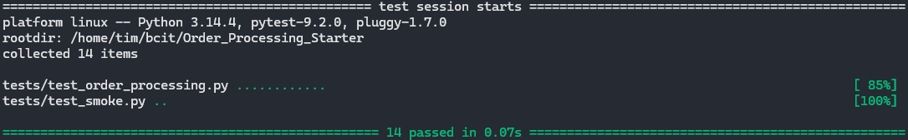
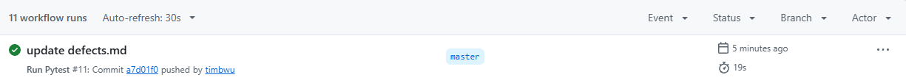

# Defects and Fixes

1. Unsafe SQL input - In `repository.py`, `get_product` and `get_saved_card` interpolates user input into SQL making it vulnerable to SQL injection. Use parameterized queries instead.

2. Unreliable connection closing - In `repository.py`, each function would skip the `conn.close()` line if `conn.execute()` threw an error leading to memory leaks. Wrap the execute and close in a `try...finally` block to guarentee the connection closes.

3. Stock can go negative - In `repository.py`, `update_stock` subtracts without checking the current stock. Check the inventory stock before updating and reject zero or negative quantities.

4. Stock is decremented before payment succeeds - In `checkout.py`, the inventory is decremented before payment is charged. Avoid making inventory changes until payment is approved.

5. Cart is cleared from any payment attempt - In `checkout.py`, any payment attempt clears the cart which doesn't let the customer retry if an error occurs. Preseve the cart after a payment attempt.

6. Checkout can be duplicated - In `checkout.py`, the `request_id` is not validated or checked before so there could be duplicated orders and charges. Return the previous result for a repeated request instead of charging again.

7. Payment token is printed - In `checkout.py`, the payment token is printed out which could expose payment data in logs or terminals. Remove it completely or print only non-sensitive data.

8. Discount is not updated from cart edits - In `cart.py`, adding or removing an item from the cart does not update the `discounted_total` so the checkout total would be based on the old cart. Re-calculate the discount after a cart edit.

# Tests

Created 12 unit tests in `test_order_processing.py` that cover the defects and core behavior:

- `test_repository_uses_parameterized_queries`
- `test_repository_closes_connection_when_query_raises`
- `test_update_stock_rejects_invalid_quantity`
- `test_declined_checkout_preserves_stock_and_cart`
- `test_approved_checkout_updates_stock`
- `test_approved_checkout_clears_cart`
- `test_repeated_request_id_does_not_charge_or_create_another_order`
- `test_checkout_rejects_blank_request_id_before_charging`
- `test_empty_cart_checkout_does_not_charge`
- `test_checkout_does_not_print_payment_token`
- `test_discount_is_recalculated_after_adding_item`
- `test_discount_is_recalculated_after_removing_item`

# Github Actions

